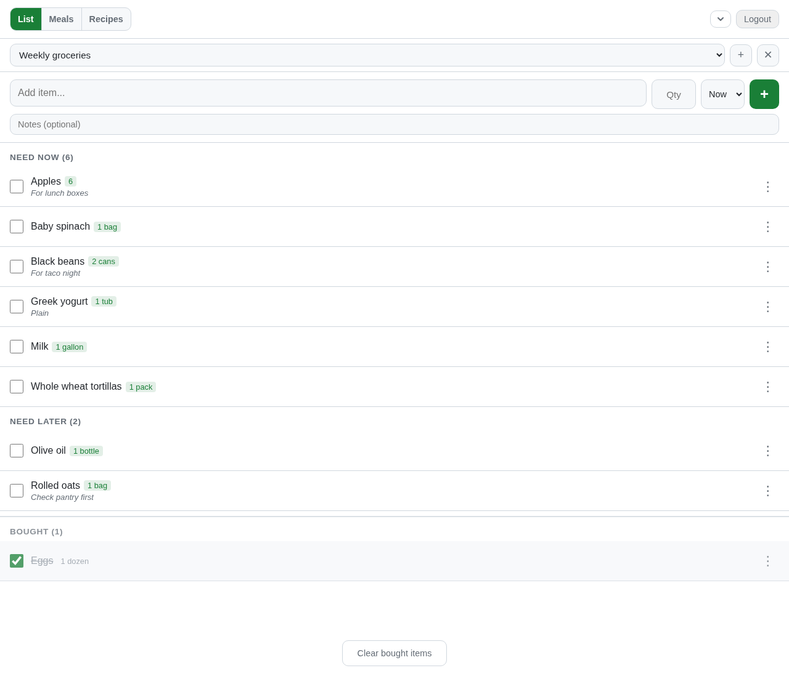
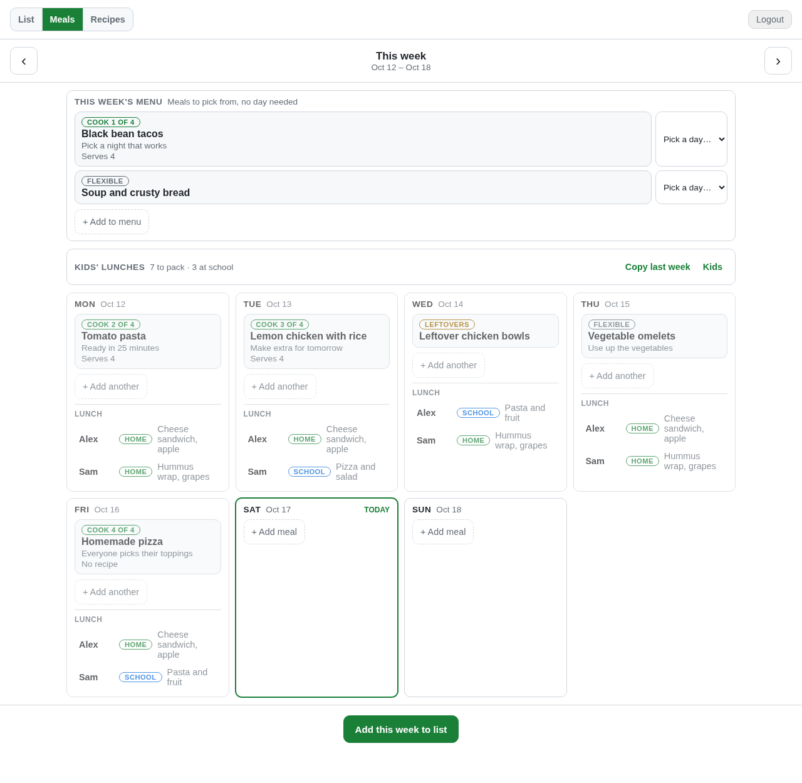
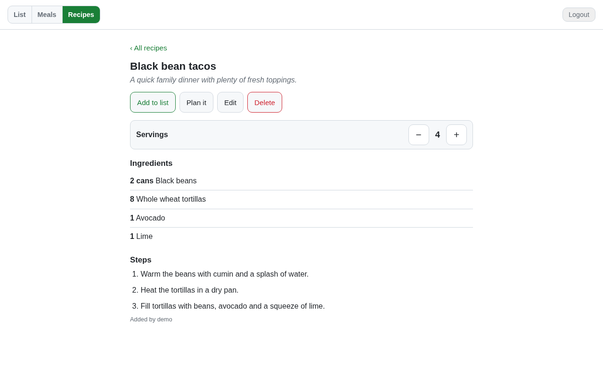
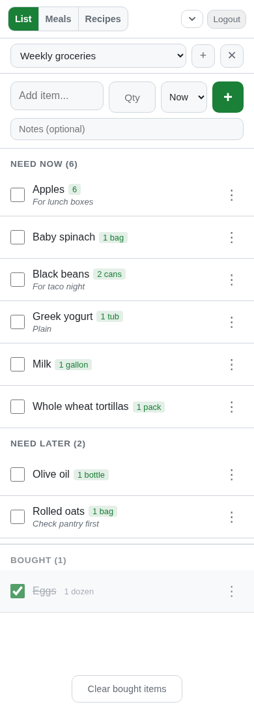

# GroceryList

A self-hosted, multi-user grocery list web app built with Flask. Items are organized into **Now** and **Later** sections, real-time updates are pushed to all connected clients via SSE, and the app works offline via a service worker with an IndexedDB sync queue.

## Features

- **Multi-user** with role-based access (user / admin)
- **Multiple lists** — create and switch between named lists
- **Two sections per list** — "Now" (active) and "Later" (saved for later)
- **Item details** — optional quantity and notes per item
- **Autocomplete** — item name history for quick re-entry
- **Real-time sync** — Server-Sent Events push changes to all open tabs/clients instantly
- **Offline support** — service worker caches the app shell; queued writes sync when connectivity returns
- **Recipes** — a shared library with structured ingredients (amount, unit, note), servings, a source link and steps; search by name, scale a recipe to any number of servings, and import from a URL (optional, needs `ANTHROPIC_API_KEY`) or JSON
- **Meal planning** — plan each day of a Monday-to-Sunday week as a cook night (a recipe or a typed dish), leftovers from an earlier cook night, or a flexible easy night
- **Week menu** — list the meals for a week without picking days, then pick a day for each one when you're ready (or just cook from the list)
- **Kids' lunches** — for each kid and school day (Mon–Fri), track whether lunch is from home or school and what they're having; copy last week's lunches in one tap
- **Ingredients to the list** — add a recipe or a week of cook nights to any list after reviewing the combined, scaled ingredients (see [Meals and recipes](#meals-and-recipes))
- **Admin panel** — user management, password resets, activation/deactivation, session revocation, audit log
- **Security** — CSRF protection, bcrypt passwords, rate limiting, strict CSP headers, HttpOnly cookies

## Screenshots

These screenshots use fictional sample data from a local demo.

### Grocery lists

Track quantities and notes, save items for later, and check off purchases.



### Weekly meals and kids' lunches

Keep meals on the week menu until you pick a day, and plan home or school lunches for each child.



### Recipes

Keep ingredients, servings, and cooking steps together, then review ingredients before adding them to a grocery list.



<details>
<summary>See the grocery list on a phone</summary>



</details>

## Stack

| Layer | Technology |
|-------|-----------|
| Backend | Python 3.14, Flask 3, gunicorn + gevent |
| Database | SQLite (WAL mode) |
| Frontend | Vanilla JS, CSS, PWA service worker |
| Container | Docker + Docker Compose |
| Tunnel | Cloudflare Tunnel (optional) |

## Quick Start

### Prerequisites

- Docker and Docker Compose

### Run with Docker Compose

Production runs the prebuilt image that CI publishes to GitHub Container
Registry (`ghcr.io/jjbasken/grocerylist`) after every push to `master` that
passes the security checks. The server only needs `docker-compose.yml`, `.env`,
and the `data/` directory; a full source checkout is not required.

1. Copy `docker-compose.yml` to the server (or clone the repo) and create a
   `.env` file:

   ```
   SECRET_KEY=your-random-secret-key-here
   # Required only until the initial administrator has been created
   BOOTSTRAP_TOKEN=your-random-one-time-setup-token
   # Optional — defaults to /data/grocery.db inside the container
   DATABASE=/data/grocery.db
   # Optional — only needed if using the Cloudflare tunnel service
   CLOUDFLARE_TUNNEL_TOKEN=your-token-here
   # Linux bind-mount ownership (use `id -u` and `id -g`)
   APP_UID=1000
   APP_GID=1000
   ```

   Generate each secret independently, for example with
   `python3 -c "import secrets; print(secrets.token_urlsafe(32))"`.

2. Start the app:

   ```bash
   mkdir -p data
   docker compose pull
   docker compose up -d
   ```

   If an existing `data/` directory was created by a root-running version of
   the container, change its ownership to the `APP_UID`/`APP_GID` configured
   above before starting the hardened non-root image.

3. Open the HTTPS hostname configured for your Cloudflare tunnel. Enter the
   one-time setup token to create the initial administrator, then remove
   `BOOTSTRAP_TOKEN` from `.env` and restart the services.

The production Compose configuration trusts one reverse-proxy hop and redirects
HTTP requests to HTTPS. For loopback-only development without the tunnel, set
`ENFORCE_HTTPS=false` and `TRUST_PROXY_HEADERS=false` in `.env`, then use
`http://localhost:5000`.

Data is persisted in the `./data/` directory on the host.

### Updating production

Once a change is merged to `master` and the `publish-image` job finishes, pull
the new image and recreate the container:

```bash
docker compose pull web
docker compose up -d
```

Each build is tagged `latest` and `sha-<full commit hash>`. To pin a specific
build or roll back, set `IMAGE_TAG=sha-<commit>` in `.env` and run the same two
commands. Remove `IMAGE_TAG` to follow `latest` again. Old images can be cleaned
up with `docker image prune`.

GHCR packages start out private. To let the server pull without logging in, set
the `grocerylist` package to public once, under **Package settings → Change
visibility** on GitHub. Otherwise run `docker login ghcr.io` on the server with
a personal access token that has only the `read:packages` scope.

To test local changes in the container, build from source instead:
`docker compose up -d --build`.

### Run Locally (no Docker)

```bash
pip install --require-hashes -r requirements.txt
export SECRET_KEY=your-secret-key
export BOOTSTRAP_TOKEN=your-one-time-setup-token
export DATABASE=grocery.db
python -c "import app; app.init_db(); app.upgrade_db()"
flask run
```

## Configuration

All configuration is via environment variables:

| Variable | Required | Default | Description |
|----------|----------|---------|-------------|
| `SECRET_KEY` | Yes | — | Flask session signing key |
| `BOOTSTRAP_TOKEN` | Initial setup | — | One-time token required to create the first administrator |
| `DATABASE` | No | `/data/grocery.db` | Path to the SQLite database file |
| `ENFORCE_HTTPS` | No | `false` | Redirect HTTP to HTTPS; Compose defaults this to `true` |
| `TRUST_PROXY_HEADERS` | No | `false` | Trust proxy client/scheme headers; enable only behind the configured tunnel |
| `TRUSTED_PROXY_HOPS` | No | `1` | Number of trusted proxy hops |
| `ANTHROPIC_API_KEY` | No | — | Enables recipe import from a URL; when unset the option is hidden |

## Cloudflare Tunnel

The `docker-compose.yml` includes an optional `tunnel` service that exposes the
app via a Cloudflare Tunnel. Set `CLOUDFLARE_TUNNEL_TOKEN` in your `.env` to
enable it. Remove or comment out the tunnel service and disable the two proxy/TLS
settings for loopback-only HTTP development. The application emits HSTS on
HTTPS responses; Cloudflare should also have **Always Use HTTPS** enabled.

The container health check calls `/healthz`, which reports whether the app can
reach its database. It needs no login, works before initial setup, and is exempt
from the HTTPS redirect so it can be called over loopback HTTP.

## Admin Panel

Navigate to `/admin/users` (admin users only) to:

- Create, activate, deactivate, and delete users
- Reset a user's password (they must change it on next login)
- Revoke all of a user's sessions
- View the 200 most recent audit log entries

## Meals and recipes

The header's **List · Meals · Recipes** switch moves between the grocery list,
the week's meal plan and the recipe library. The list stays the home page: when
meals are planned for the next seven days, a small strip under the add bar shows
what's for dinner and offers **Add ingredients**. With nothing planned, the list
looks exactly as it always has.

- **Recipes:** each ingredient has a name, an amount (`2`, `1.5`, `1/2`, `1 1/2` or `1½`), a unit and a note. You can paste a block of ingredient lines and they're split into those fields. A recipe page has a servings stepper that rescales every amount, plus **Add to list** and **Plan it**.
- **Meals:** tap a day to add a cook night, leftovers or a flexible night, and tap a meal to edit, move or remove it. Cook nights are numbered ("Cook 2 of 4"). Deleting a recipe keeps any planned meals that used it, by name.
- **Adding ingredients:** **Add this week to list** (or a recipe's **Add to list**) opens a review sheet before anything is written:
  - Only cook nights with a recipe contribute ingredients, each scaled to the meal's servings.
  - Matching ingredients are combined across meals, ignoring case and simple plurals. Volumes and weights are converted and summed ("1 lb" + "16 oz" → "2 lb"); other units are listed side by side ("8 oz + 2 cans").
  - Each item gets a note saying which meals need it ("for Tacos, Chili").
  - **Already on the list and not bought:** the amounts are combined into that item instead of adding a duplicate. If the existing quantity can't be read, the extra amount goes in its notes.
  - **Already bought:** unticked by default and labelled "Bought — still need?".
  - Cook nights without a recipe are listed so you can add their ingredients by hand.
  - Afterwards the meals show "✓ On <list>", and adding them again warns first.

Recipes and meals are shared by the whole household, like lists. Only a recipe's
creator or an admin can delete it. These pages need a connection; offline, the
grocery list works as before and the meals strip is hidden.

## Security upgrade and offline storage

The account-identity migration runs automatically on startup. Existing users
must sign in again once after upgrading. Let connected devices finish syncing
before deploying: the updated service worker removes legacy offline caches and
queued changes because they cannot safely be assigned to an account.

Offline sync requires a current browser with Web Locks support (current Chrome,
Edge, Firefox, and Safari). Queue replay is serialized across tabs, temporary
server errors and rate limits retain pending writes for retry, and app-shell
updates preserve current account caches and queued changes. Reopening the app
or switching lists reconstructs pending changes over the cached server data.

Offline data belongs to the account that loaded the page. Logout, sign-in,
password changes, and account switches clear private browser caches and pending
changes. API writes require an `X-Account-ID` header matching the authenticated
account, in addition to the CSRF token. The frontend sets both automatically;
custom API clients can obtain the account identity from the `X-Account-ID`
response header on `/api/csrf-token`.

Run backend regressions with `python -m pytest -q` and browser-script regressions
with `node tests/offline-security.test.js` (Node.js 22 or newer).

Dependencies used by production and CI are fully resolved in hash-locked files.
Direct dependencies are declared in `requirements.in` and `requirements-dev.in`;
`requirements.txt` and `requirements-dev.txt` are generated from them. After
changing an `.in` file, regenerate its `.txt` with
`pip-compile --generate-hashes --allow-unsafe --strip-extras <file>.in`
(Dependabot does this automatically for its update PRs). GitHub Actions runs tests,
dependency auditing, Bandit, a full-history secret scan, and a production
container build, and publishes the image to GHCR from `master`. Dependabot checks Python, Docker, and GitHub Actions inputs
weekly.

## Pull requests and security

The default branch is currently `master`. Repository rules protect both `master`
and `main` (and follow the default branch if it changes). Changes require a pull
request, passing security checks, and resolved review conversations. Direct pushes,
force pushes, and branch deletion are blocked. These core protections have no
bypass actors.

A separate native GitHub review ruleset requires one approving review from a code
owner listed in `.github/CODEOWNERS` (currently `jjbasken`). GitHub does not let an
author approve their own PR review, so `jjbasken` alone can bypass this **review
ruleset through a PR**. When merging your own PR, use GitHub's review-bypass option;
you do not need a second reviewer or a separate deployment approval. This bypass
does not waive the PR requirement, security checks, or other core protections.
Other contributors must obtain a code owner's approval.

To add approvers, update `.github/CODEOWNERS` and keep Dependabot's review requests
aligned. The owner-only bypass is configured separately in the repository's
**Settings → Rules → Rulesets**, and applies only to the review ruleset.

Dependabot checks Python dependencies, container images, and GitHub Actions weekly
and opens security update PRs. GitHub secret scanning and push protection scan for
leaked credentials. CodeQL default setup scans Python, JavaScript, and Actions;
the branch rules block new high/critical security findings and error-level code
scanning findings. CI also runs pip-audit, Bandit, Gitleaks, backend and browser
regressions, a container build, and dependency review on PRs. Scheduled security
checks run weekly so existing dependencies continue to be audited.

## Project Structure

```
app.py           # Flask application and all routes
config.py        # Environment-based configuration
conftest.py      # pytest fixtures
schema.sql       # Database schema (initial creation)
requirements.in   # Direct dependencies
requirements.txt  # Hash-locked, generated by pip-compile
requirements-dev.in / requirements-dev.txt  # Test/CI tooling
tests/           # pytest suite + offline security JS test
Dockerfile
docker-compose.yml
ingredients.py   # Ingredient parsing, unit conversion, scaling and combining
static/
  app.js         # Main frontend logic (grocery list)
  page-api.js    # Shared fetch/modal/date helpers for the recipes and meals pages
  recipes.js     # Recipe library, detail and editor
  meals.js       # Weekly meal plan
  shopping-review.js  # Review sheet for adding ingredients to a list
  sw.js          # Service worker (offline + sync queue)
  style.css
  manifest.webmanifest
templates/       # Jinja2 HTML templates
```

## License

[GNU General Public License v3.0](LICENSE)
